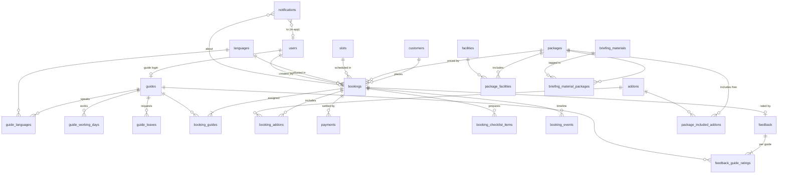
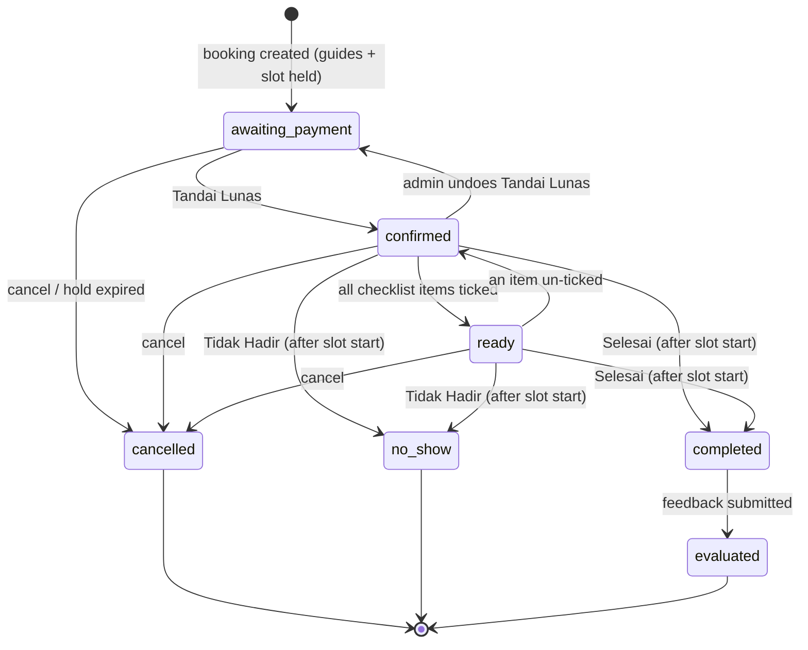

# 00 — Overview: TMII Tour Guide Booking (Prototype)

> Status: **Draft v1** · Last updated: 2026-10-25
> Read this first. Every module spec (`01`–`11`) and [`design-system.md`](design-system.md) builds on the decisions here. If a module spec contradicts this file, this file wins until the conflict is resolved explicitly.

---

## 1. Context

**Taman Mini Indonesia Indah (TMII)** is a culture-based recreational park in East Jakarta, operated since July 2021 by InJourney Destination Management. TMII offers paid tour guides for **foreign tourists** (wisatawan mancanegara).

The source process is the infographic *"Place Order Tour Guide — Alur Pemesanan Tour Guide TMII"* (`project spec.jpeg`). It defines seven steps:

| # | Step (Indonesian) | Meaning |
|---|---|---|
| 1 | Inquiry & Pitching | Tourist hears about the service via **Sales (outbound)**, **Call Center (inbound)**, or **On the Spot (visitor)** |
| 2 | Cek Ketersediaan & Penjadwalan | Staff check guide availability in real time by date, slot, language, and group size |
| 3 | Alokasi Tour Guide | System recommends suitable guides (availability, language, special needs, e.g. Fast Track) |
| 4 | Konfirmasi & Pembayaran | Schedule, guide, package price and facilities are confirmed; payment is settled |
| 5 | Persiapan Sebelum Tour | Guide notified at least **H-2**; briefing material, facilities, coordination with operations |
| 6 | Pelaksanaan Tour | Guide accompanies tourists with the prepared facilities |
| 7 | Evaluasi & Follow Up | Customer feedback, sales performance data, repeat-visit opportunities |

Pain points the system must remove (from the infographic):

1. Real-time guide availability check (8 guides, "8 HC").
2. Guides notified at least H-2.
3. Slot-based scheduling that respects language skills.
4. Clear package and price information from the start.
5. Cross-team coordination (sales, call center, operations, guides).

## 2. Product summary

An **internal web app** for TMII staff to take tour-guide bookings for foreign tourists, allocate guides, confirm payment, prepare the tour, and evaluate it afterwards. It also has a **guide portal**, where guides see their assignments, and an **admin panel** for guides, pricing, add-ons, and settings.

- **Users are staff only.** Tourists never log in. The single public page is the tourist feedback form `/ulasan/[token]`.
- **UI language: Indonesian.** Tourist-facing text (feedback page, mock WhatsApp messages) is **English**.
- **Responsive**: every screen works on mobile (≥ 360 px) and desktop. The guide portal is designed mobile-first.
- **Prototype**: correctness of the business flow matters more than scale. No real payments, no real WhatsApp/email.

## 3. Scope

### In scope

- Login and role-based access (Admin, Staff, Guide)
- Master data: tour guides (languages, working days, leave), languages, slots, packages, add-ons, price rules, holidays, checklist template, briefing material, settings
- Booking flow: customer intake → availability check → guide allocation → booking with price snapshot → payment confirmation → preparation checklist → tour completion → feedback
- Rescheduling and cancellation; automatic expiry of unpaid holds
- Guide portal: schedule, tour detail, "Saya siap" acknowledgement, finishing a tour, leave requests
- Simulated notifications (outbox + in-app bell)
- Public tourist feedback page
- Home dashboard (Beranda), schedule board (Papan Jadwal), reports with CSV export
- Seed data for a populated demo
- Deployment to Vercel

### Out of scope (prototype)

- Tourist self-service booking or tourist accounts
- Online payment gateway, instalments, refund calculation
- Real WhatsApp / email / SMS delivery; editable message templates
- Password reset by email, SSO, 2FA
- Inventory / stock of facilities (snacks, vouchers)
- Multi-currency (IDR only)
- Dark mode; Arabic/Russian UI (the dictionary structure allows adding them later)
- End-to-end tests

## 4. Roles and permissions

| Role | Who | Home screen |
|---|---|---|
| **Admin** | Tour-guide service manager | Beranda (home dashboard) |
| **Staff** | Sales, Call Center, and Operations staff (one role; the booking records the channel) | Beranda (home dashboard) |
| **Guide** | Each of the tour guides | Portal Guide (`/portal`) |

Permission matrix (enforced **server-side** on every action, not just hidden in the UI):

| Capability | Admin | Staff | Guide |
|---|:-:|:-:|:-:|
| Master data: guides, pricing (packages, add-ons, rules, holidays) | ✅ edit | 👁 view | ❌ |
| Settings (slots, languages, checklist, briefing material, limits) and users | ✅ edit | ❌ | ❌ |
| Create / edit / reschedule / cancel bookings | ✅ | ✅ | ❌ |
| Attach payment proof, "Tandai Lunas" (mark paid) | ✅ | ✅ | ❌ |
| Undo "Tandai Lunas" | ✅ (with reason) | ❌ | ❌ |
| Preparation checklist | ✅ | ✅ | ❌ (only via "Saya siap") |
| Mark "Selesai" / "Tidak Hadir" | ✅ | ✅ | ✅ own tours only |
| See prices and payment details | ✅ | ✅ | ❌ |
| Enter feedback on the tourist's behalf | ✅ | ✅ | ✅ own tours only |
| Approve / reject leave requests | ✅ | ❌ | ❌ (requests own) |
| Reports | ✅ | 👁 read-only | ❌ |
| Outbox page | ✅ | ❌ | ❌ |
| Notification bell | ✅ | ✅ | ✅ |

Every booking records **`channel`** (`sales` · `call_center` · `on_the_spot`) and **`created_by`** (the staff user). Each staff user has an optional **default channel** that pre-fills the booking form.

## 5. Module map

| File | Module | Covers | Spec flow step |
|---|---|---|---|
| [`00-overview.md`](00-overview.md) | Overview | This document | — |
| [`design-system.md`](design-system.md) | Design system | Tokens, typography, layout, components, brand and decoration usage, motion | — |
| `01-auth-pengguna.md` | Auth & users | Login, sessions, roles, user management, default channel | — |
| `02-tour-guide.md` | Tour guides | Guide profiles, languages, working days, leave (request → approve) | 2, 3 |
| `03-harga.md` | Pricing | Packages, add-ons, price rules (weekend/holiday), holidays, price simulator | 4 |
| `04-pengaturan.md` | Settings | Slots, languages, checklist template, briefing material, hold expiry, booking horizon | 2, 5 |
| `05-pemesanan.md` | Booking | Customer intake, availability check, guide allocation, booking record, Papan Jadwal, reschedule, cancel, timeline | 1, 2, 3, 4 |
| `06-pembayaran.md` | Payment | Payment method, proof image / reference, "Tandai Lunas", undo | 4 |
| `07-persiapan.md` | Preparation | Checklist instance, H-2 notice, "Siap" auto-transition | 5 |
| `08-portal-guide.md` | Guide portal | Schedule, tour detail, "Saya siap", finish tour, leave requests | 5, 6 |
| `09-notifikasi.md` | Notifications | Outbox, in-app bell, event catalogue, templates | 4, 5, 7 |
| `10-ulasan.md` | Feedback | Public feedback page, token links, staff fallback, low-rating alert | 7 |
| `11-beranda-laporan.md` | Home & reports | Beranda, KPIs, charts, guide performance, CSV export | 7 |
| [`12-perubahan-fase-2.md`](12-perubahan-fase-2.md) | Phase-2 changes | Merge bookings (shared tour), payment-confirmation bypass flag, team email via SMTP with xlsx, admin force confirm | 2, 4, 5 |

Dependency order for implementation: `01 → 04 → 02 → 03 → 05 → 06 → 07 → 09 → 08 → 10 → 11 → 12`.

## 6. Domain model (high level)

Field-level detail lives in each module spec. Conventions: table and column names are **English snake_case**; IDs are text UUIDs unless stated; all tables have `created_at` and `updated_at`; "deactivate" means `is_active = false` (see §8.4).



| Entity | Purpose | Module |
|---|---|---|
| `users` | Login accounts with `role` (`admin` · `staff` · `guide`), `default_channel` | 01 |
| `guides` | Guide profile (name, photo, phone, `user_id`) | 02 |
| `guide_languages`, `guide_working_days`, `guide_leaves` | Availability inputs; leave has `status` (`pending` · `approved` · `rejected`) | 02 |
| `languages` | Admin-managed list (seeded English, Arabic, Russian) | 04 |
| `slots` | Admin-managed time slots (default 09:00–12:00, 12:00–15:00, 16:00–19:00) | 04 |
| `packages`, `package_facilities`, `package_included_addons` | Package price per guide, max people per guide, included facilities and add-ons | 03 |
| `facilities` | Non-chargeable items a package includes (snack, water, vouchers, waiting room) | 03 |
| `addons` | Extra items priced `per_booking` or `per_person` | 03 |
| `price_rules`, `holidays` | Weekend / holiday surcharges; holiday dates | 03 |
| `customers` | Tourist identity; unique normalised WhatsApp number | 05 |
| `bookings` | The order: date, slot, language, people, package, status, channel, `created_by`, **price snapshot** | 05 |
| `booking_guides` | Guide assignments (1..n), each with `acknowledged_at` ("Saya siap") | 05, 08 |
| `booking_addons` | Selected add-ons with snapshot price | 05 |
| `payments` | Method, amount received, proof file / reference, `confirmed_by`, `voided_at` | 06 |
| `checklist_template_items`, `booking_checklist_items` | Template and per-booking copy | 04, 07 |
| `briefing_materials` (+ package tags) | Title, rich text, optional link / PDF | 04 |
| `notifications` | Outbox: recipient, channel (`in_app` · `whatsapp_mock`), template key, rendered body, `read_at` | 09 |
| `feedback` | One per completed booking: token, `token_expires_at`, overall rating, comment, would-revisit, consent, `source` (`tourist` · `staff` · `guide`) | 10 |
| `feedback_guide_ratings` | One rating (1–5) per assigned guide per feedback | 10 |
| `booking_events` | Append-only audit log: type, actor, payload, timestamp | 05 |
| `settings` | Key/value: `hold_expiry_hours`, `booking_horizon_days`, `notice_days`, `feedback_link_days`, `low_rating_threshold`, `payment_instructions_en` | 04 |

## 7. Booking lifecycle

Statuses are stored as English enums and shown with Indonesian labels:

| Enum | UI label | Meaning |
|---|---|---|
| `awaiting_payment` | **Menunggu Pembayaran** | Created; guides and slot are held until the hold expires |
| `confirmed` | **Terkonfirmasi** | Payment confirmed ("Tandai Lunas") |
| `ready` | **Siap** | Every checklist item is ticked (automatic) |
| `completed` | **Selesai** | Tour done (set by a guide or staff after the slot starts) |
| `evaluated` | **Dievaluasi** | Feedback received |
| `no_show` | **Tidak Hadir** | Tourist did not show up |
| `cancelled` | **Dibatalkan** | Cancelled by staff, or hold expired ("Kedaluwarsa otomatis") |



Key rules (detailed in modules 05–10):

- **Holds**: an `awaiting_payment` booking blocks its guides and slot. It expires `hold_expiry_hours` (default **24**) after creation, or at the slot start if that is earlier (payment must happen before the tour), stored as `bookings.hold_expires_at` when the booking is created. Expiry is **evaluated lazily**: on every read of bookings or availability, overdue holds are moved to `cancelled` with reason "Kedaluwarsa otomatis" and an event is logged. No cron job.
- **Reschedule** (date, slot, or guides) is allowed in `awaiting_payment`, `confirmed`, and `ready`. Availability is re-checked and the price is recalculated. A price difference is shown for staff to settle manually. Released guides are notified.
- **Cancel** needs a reason (fixed list) and an optional refund note. No refund calculation.
- **Group size**: guides needed = ⌈people ÷ package `max_people_per_guide`⌉. Every assigned guide must speak the booking language. If not enough guides are free, that slot is unavailable for that group. No partial bookings.
- **One language per booking.** Mixed-language groups become separate bookings (optionally linked via `group_ref`).
- **Booking window**: any slot that has not started yet (same-day allowed), up to `booking_horizon_days` (default **90**) ahead.

## 8. Cross-cutting rules

### 8.1 Time, formats, identifiers

- **Timezone**: everything is interpreted in **Asia/Jakarta (WIB, UTC+7)**. Store dates as `YYYY-MM-DD` text and slot times as `HH:mm`. Store timestamps as UTC ISO strings and render them in WIB.
- **Dates**: `Sabtu, 25 Okt 2026` (long), `25/10/2026` (compact tables). Use `Intl.DateTimeFormat('id-ID', { timeZone: 'Asia/Jakarta' })`.
- **Currency**: `Rp 500.000` (IDR, no decimals). Store money as **integer rupiah**.
- **Phone**: WhatsApp numbers are normalised to E.164 (`+62…`, `+966…`). This is the customer's unique key.
- **Booking code**: `TG-YYMMDD-NNN`, where the date is the **creation** date (WIB) and NNN is a daily sequence starting at 001. Example: `TG-261025-004`.

### 8.2 Pricing snapshot

When a booking is created or rescheduled, the full price breakdown (package price per guide × guides, surcharge rule applied, add-on lines, total) is stored on the booking as a JSON snapshot. Later price changes never alter existing bookings. See `03-harga.md`.

### 8.3 Audit trail (`booking_events`)

Every state-changing action on a booking appends an event: `created`, `status_changed`, `guide_assigned`, `guide_released`, `rescheduled`, `payment_confirmed`, `payment_voided`, `checklist_ticked`, `checklist_unticked`, `guide_acknowledged`, `notification_sent`, `notes_updated`, `adjustment_recorded`, `feedback_received`, `cancelled`, `hold_expired`. Each event records `actor_user_id` (null for system), `at`, and a JSON `payload`. Shown as the **Riwayat** (history) timeline on the booking detail page. Events are never edited or deleted.

### 8.4 Soft delete only

Users, guides, languages, packages, add-ons, slots, price rules, and briefing materials are **deactivated, never deleted**. Inactive records disappear from pickers but remain visible on historical bookings and in reports. Holidays and checklist template items may be hard-deleted because bookings copy what they need.

### 8.5 Notifications

All messages go through one `notify(event, context)` function that writes rows to `notifications`. Internal recipients get `in_app` rows (Indonesian), shown in the bell. Tourists get `whatsapp_mock` rows (English), visible only in the admin **Outbox**. Templates are fixed in code. See `09-notifikasi.md`.

### 8.6 Language and copy

- **UI copy**: Indonesian, kept in `src/i18n/id.ts`. No hard-coded strings in components.
- **Tourist-facing copy** (feedback page, WhatsApp mocks): English, kept in `src/i18n/en.ts`.
- **Code, database, enums, and API**: English.
- The dictionary structure must allow adding locales later (including RTL for Arabic) without touching components.

### 8.7 Security baseline (prototype)

- Passwords hashed with bcrypt. Sessions via Auth.js (JWT cookie, HTTP-only).
- Every server action checks role and ownership (e.g. guides can act only on bookings they are assigned to).
- Uploads: images (JPEG/PNG/WebP) ≤ 5 MB for payment proof; PDF ≤ 10 MB for briefing material. Validate MIME type and size server-side.
- Feedback tokens are random, at least 128-bit, single-use, and expire after `feedback_link_days` (default **14**).

## 9. Architecture

| Concern | Choice |
|---|---|
| Framework | **Next.js (App Router)** + **TypeScript**, server actions for mutations |
| Styling / UI | **Tailwind CSS** + **shadcn/ui** (Radix), **lucide** icons, **Recharts**, **Motion** for brand animation |
| Database | **SQLite dialect via libSQL**: local `file:local.db` in development, **Turso** on Vercel |
| ORM / migrations | **Drizzle ORM** + drizzle-kit migrations; seed script `npm run db:seed` |
| Auth | **Auth.js (NextAuth v5)** Credentials provider, bcrypt |
| File storage | `StorageAdapter` interface: local disk (`public/uploads`) in development, **Vercel Blob** in production |
| Tests | **Vitest** for the pure domain logic |
| Hosting | **Vercel** |

### 9.1 Proposed structure

```
src/
  app/
    (auth)/masuk/                 login
    (staff)/beranda/              home dashboard              [admin, staff]
    (staff)/pemesanan/            bookings list / new / [id]  [admin, staff]
    (staff)/jadwal/               Papan Jadwal                [admin, staff]
    (staff)/pelanggan/            customers                   [admin, staff]
    (staff)/laporan/              reports                     [admin, staff(read)]
    (staff)/tour-guide/           guides + leave approvals    [admin; staff view]
    (staff)/harga/                packages, add-ons, rules    [admin; staff view]
    (staff)/pengaturan/           settings, slots, languages, checklist, briefing [admin]
    (staff)/pengguna/             users                       [admin]
    (staff)/outbox/               notification outbox         [admin]
    (guide)/portal/               guide portal                [guide]
    ulasan/[token]/               public feedback page (English)
  domain/        pure logic, no I/O: pricing.ts, availability.ts, allocation.ts,
                 booking-status.ts, hold.ts, booking-code.ts, phone.ts
  server/        server actions and queries per module (role checks live here)
  db/            schema.ts, client.ts, seed.ts, migrations/
  lib/           format.ts (id-ID dates/currency), storage/, notify/, auth.ts
  i18n/          id.ts, en.ts
  components/    ui/ (shadcn), brand/ (Logo, DecoratedLogo), feature components
public/brand/    logo + decoration SVGs (copied from webAsset/)
```

URL paths are Indonesian to match the UI. Code identifiers are English.

### 9.2 Environments

| Variable | Local | Vercel |
|---|---|---|
| `DATABASE_URL` | `file:local.db` | `libsql://<db>.turso.io` |
| `DATABASE_AUTH_TOKEN` | — | Turso token |
| `AUTH_SECRET` | any random string | generated secret |
| `STORAGE_DRIVER` | `local` | `vercel-blob` |
| `BLOB_READ_WRITE_TOKEN` | — | Vercel Blob token |
| `APP_BASE_URL` | `http://localhost:3000` | production URL (used in feedback links) |
| `PAYMENT_CONFIRMATION` | unset (off) | unset (off); `true` restores 06 ([`12` BR-12-P1](12-perubahan-fase-2.md#5-business-rules)) |
| `SMTP_HOST` / `SMTP_PORT` / `SMTP_SECURE` | local sink, e.g. `localhost` / `1025` / `false` | provider values |
| `SMTP_USER` / `SMTP_PASSWORD` / `SMTP_FROM` | — / — / any sender | provider credentials and sender ([`12` §4](12-perubahan-fase-2.md#4-data-model)) |

## 10. Seed data

`npm run db:seed` resets and fills the database:

- **Users** (password `tmii1234` for all, documented in the README):
  - Admin: `admin@tmii.test`
  - Staff: `sales@tmii.test` (default channel Sales), `callcenter@tmii.test` (Call Center), `ops@tmii.test` (On the Spot)
  - Guides: one login each, `<firstname>@tmii.test`
- **Guides (8)** with realistic Indonesian names. All speak English, 3 also Arabic, 2 also Russian. Varied working days, plus a few approved and pending leave dates.
- **Languages**: English, Arabic, Russian. **Slots**: 09:00–12:00, 12:00–15:00, 16:00–19:00.
- **Pricing**:

  | Package | Max people / guide | Price / guide | Includes |
  |---|---|---|---|
  | Reguler | 8 | Rp 500.000 | Snack, mineral water, merchandise voucher, Sarinah & FnB voucher, waiting room |
  | Premium | 8 | Rp 750.000 | Reguler + Fast Track (Angling) |
  | VIP Private | 4 | Rp 1.200.000 | Premium + exclusive waiting room |

  Add-ons: Fast Track (Angling) Rp 50.000 / person (hidden when the package already includes it), photo documentation Rp 150.000 / booking, extra snack box Rp 25.000 / person.
  Price rules: weekend +20 %, national holiday +25 %. If both apply, only the higher one is used. Surcharges apply to the package subtotal only. 2026–2027 Indonesian national holidays seeded.
- **Checklist template**: guide notified, briefing material, facilities prepared, operations team confirmed.
- **Bookings**: about 60 days of history plus about 14 days ahead, across every status, channel, language, and slot, with payments, feedback, and events, so Beranda, reports, and timelines are populated.

## 11. Non-functional requirements

- **Responsive**: works from 360 px to 1440 px+. See [`design-system.md`](design-system.md) §6.
- **Accessibility**: WCAG 2.2 AA contrast, keyboard navigable, visible focus, status never conveyed by colour alone, `prefers-reduced-motion` respected.
- **Performance** (prototype-grade): pages interactive in < 2 s on a mid-range phone over 4G; availability check responds in < 500 ms for the seeded data.
- **Data integrity**: double-booking a guide in the same date + slot must be impossible, even with concurrent requests. Enforce this with a unique index on `(guide_id, date, slot_id)` over active assignments, plus a re-check inside the create transaction.

## 12. Testing approach

Vitest unit tests cover the pure modules in `src/domain/`:

- **Pricing**: guides needed, surcharge selection (weekend vs holiday, the higher wins), add-on per person / per booking, add-ons already included in the package
- **Availability**: language, working day, approved leave, existing assignments, active holds, slot already started, horizon limit
- **Allocation ranking**: weekly workload ascending, then average rating descending, then name
- **Status transitions**: allowed and forbidden transitions, time guard for Selesai / Tidak Hadir
- **Hold expiry**: boundary at exactly `hold_expiry_hours`
- **Booking code** and **phone normalisation**

Each module spec ends with **acceptance criteria** written as Given / When / Then so they can be turned into tests later.

## 13. Module spec template

Every `NN-*.md` file uses these sections:

1. **Purpose**: one paragraph; which flow steps it serves
2. **User stories**: "As a [role], I want …, so that …"
3. **Screens**: per screen, the route, the role, the layout on desktop and mobile, the states (empty / loading / error), and the exact Indonesian labels in quotes
4. **Data model**: tables and columns owned by this module, with types and constraints
5. **Business rules**: numbered, testable
6. **Server actions / queries**: name, input, output, permission, side effects (events, notifications)
7. **Notifications**: events this module emits
8. **Edge cases**
9. **Out of scope**
10. **Acceptance criteria**: Given / When / Then

## 14. Glossary (Indonesian UI ↔ English)

| Indonesian (UI label) | English | Notes |
|---|---|---|
| Beranda | Home (dashboard) | Admin and staff landing page |
| Pemesanan | Booking | Also the module name |
| Buat Pemesanan | New booking | |
| Papan Jadwal | Schedule board | Guides × slots grid |
| Pelanggan | Customer | The tourist |
| Pelanggan kembali (×N) | Returning customer (N visits) | Badge |
| Wisatawan mancanegara (wisman) | Foreign tourist | |
| Tour Guide / Pemandu | Tour guide | "Tour Guide" is used in navigation |
| Paket | Package | |
| Harga | Price / Pricing | |
| Add-on / Tambahan | Add-on | |
| Fasilitas | Facility | Included items (snack, water, vouchers…) |
| Aturan Harga | Price rule | Weekend / holiday surcharge |
| Hari Libur | Holiday | |
| Simulasi Harga | Price simulator | |
| Slot / Sesi | Time slot | |
| Bahasa | Language | |
| Hari Kerja | Working days | |
| Cuti | Leave | |
| Ajukan Cuti | Request leave | |
| Ketersediaan | Availability | |
| Cek Ketersediaan | Check availability | |
| Alokasi | Allocation | |
| Rekomendasi | Recommended | Top-ranked guide suggestion |
| Beban minggu ini | Workload this week | Ranking input |
| Kanal | Channel | Sales · Call Center · On the Spot |
| Pembayaran | Payment | |
| Bukti Pembayaran | Payment proof | Image upload |
| Nomor Referensi | Reference number | |
| Metode Pembayaran | Payment method | Transfer Bank · QRIS · Tunai · EDC |
| Tandai Lunas | Mark as paid | |
| Batalkan Tandai Lunas | Undo mark as paid | Admin only |
| Persiapan | Preparation | |
| Daftar Periksa | Checklist | |
| Materi Briefing | Briefing material | |
| Saya siap | I'm ready | Guide acknowledgement of the H-2 notice |
| H-2 | Two days before (D-2) | Notice target |
| di bawah H-2 | Under two days' notice | Flag |
| Jadwalkan Ulang | Reschedule | |
| Batalkan Pemesanan | Cancel booking | |
| Alasan Pembatalan | Cancellation reason | |
| Kedaluwarsa otomatis | Expired automatically | System cancellation reason |
| Riwayat | History / timeline | Booking events |
| Ulasan | Feedback / review | |
| Notifikasi | Notification | |
| Outbox | Outbox | Admin list of all messages |
| Laporan | Reports | |
| Pengaturan | Settings | |
| Pengguna | Users | |
| Masuk / Keluar | Log in / Log out | |
| Simpan / Batal | Save / Cancel | |
| Nonaktifkan / Aktifkan | Deactivate / Activate | Soft delete |
| Menunggu Pembayaran · Terkonfirmasi · Siap · Selesai · Dievaluasi · Tidak Hadir · Dibatalkan | Booking statuses | See §7 |

## 15. Future considerations (not in this prototype)

- Payment gateway (Midtrans / Xendit) behind a `PaymentProvider` interface
- Real WhatsApp Business API / email delivery from the outbox
- Tourist self-service booking site (English, Arabic RTL, Russian)
- Promo codes for repeat visitors
- Guide availability per slot (partial days) and guide skill tags beyond language
